# Detect, isolate, recover: rotor-fault tolerance for a 5-inch quadrotor

*A simulation study, with all code, data and figures reproducible from fixed seeds.*
Rami Kronbi (independent researcher), 2026.

## Abstract

<!-- BEGIN:abstract -->
We study rotor-fault tolerance for a simulated 5-inch FPV-class quadrotor (0.64 kg, thrust-to-weight 3.6) with sensor noise, a 10 ms motion-capture latency, parameter uncertainty and light turbulence. An online estimator of the four rotor effectiveness factors (filtered rigid-body regression, Kalman filter) feeds a bank of CUSUM tests for detection and isolation; a supervisor then either re-allocates thrust with the estimated effectiveness (partial loss) or, when a rotor can no longer carry its share of the weight, switches to a yaw-relaxed controller in the spirit of Mueller and D'Andrea (2014) that spins the vehicle about a tilted primary axis (gain-scheduled LQR on the reduced attitude). In 200 Monte-Carlo runs with 20-90 % loss of effectiveness, all faults were detected (median delay 30 ms, 95th percentile 58 ms), all were isolated to the correct rotor, with a median magnitude error of 1.5 percentage points; no false alarm occurred in 32 min of fault-free flight. With a 50 % loss in hover the median peak deviation drops from 28 cm (passive) to 4.3 cm. After a complete rotor loss in hover the passive controller lost the vehicle in 32/32 runs (median 0.30 s), while the proposed pipeline recovered 32/32 with a median peak deviation of 38 cm and a spin of 23 rad/s; it also recovered 24/24 complete losses during a 3.3 m/s figure-eight. These are simulation results with assumed, not identified, parameters; in the robustness sweeps complete-loss recovery started to fail at an actuator delay of 24 ms (2 ms assumed), a motor time constant of 80 ms (25 ms assumed) and 3x the default turbulence.
<!-- END:abstract -->

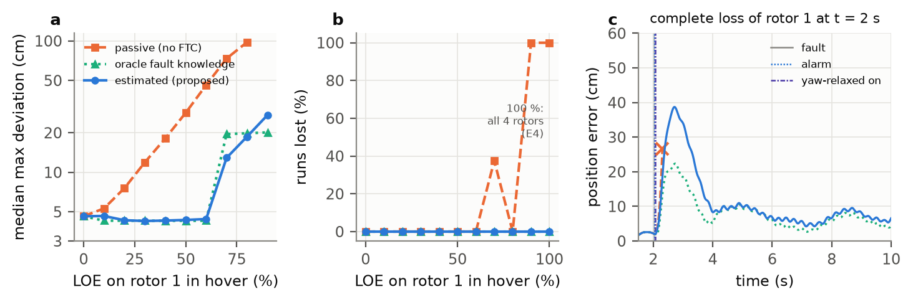

*Key figure. (a) Peak position deviation after a step loss of effectiveness (LOE) on one
rotor in hover, median of 8 seeds; (b) fraction of runs in which the vehicle was lost
(the 100 % point is the complete loss of each of the four rotors, experiment E4); (c) one
complete loss of rotor 1 at t = 2 s: the passive controller flips within about 0.3 s;
the proposed pipeline detects the fault after about 20 ms, switches to yaw-relaxed
control about 60 ms after the failure and holds position while the vehicle spins at
about 23 rad/s.*

---

## 1. Problem

A quadrotor has exactly as many actuators as it has controlled degrees of freedom
(collective thrust and three body torques). A chipped propeller, a prop strike, a
loose motor or a dead ESC channel therefore cannot be routed around the way it can on
a hexacopter: a partial loss has to be detected and compensated before the attitude
loop saturates, and a complete loss can only be survived by giving up yaw.

I wanted to answer three concrete questions for the kind of vehicle I build and fly, a
5-inch FPV quad:

1. How quickly and reliably can a loss of effectiveness on one rotor be **detected,
   isolated and quantified** from the IMU and a position/attitude reference alone
   (no RPM telemetry), with realistic noise, latency, parameter spread and turbulence?
2. How much does **using that estimate** in the controller help, compared with a
   passive controller and with a controller that is told the fault (oracle)?
3. Can the same pipeline handle the **complete loss of one rotor** with a yaw-relaxed
   controller in the spirit of Mueller and D'Andrea [2, 3], and **where does it break**?

Everything here is simulation. The vehicle parameters are assumed from a mass budget and
typical component data, not identified on a real airframe (Section 6).

## 2. Approach

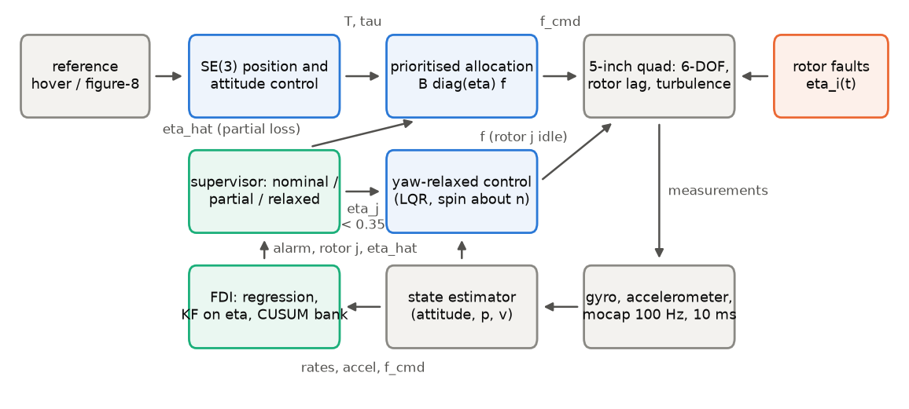

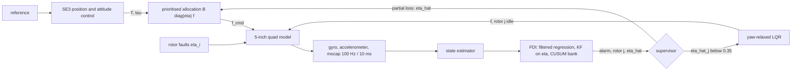

### 2.1 Vehicle and environment model (`params.py`, `dynamics.py`, `sensors.py`, `disturbance.py`)

6-DOF rigid body, unit-quaternion attitude, Euler equation with body and rotor
gyroscopic terms (`omega x (J omega + h_r)`) and the reaction torque of accelerating
rotors, first-order rotor-speed lag with saturation, thrust `f = k_f Omega^2`, linear
(rotor-drag) and quadratic body drag, rotational damping. Fixed-step RK4 at 1 kHz;
estimation, FDI and control at 500 Hz; one control period (2 ms) of actuator transport
delay. Every parameter is an assumption, chosen as follows:

| quantity | value | how it was chosen |
|---|---|---|
| mass | 0.638 kg | mass budget: 4S 1500 mAh pack 200 g, frame plates 60 g, stack 30 g, FPV system 50 g, small HD camera 70 g, hardware 30 g, arms 4 x 12 g, motor + prop 4 x 37.5 g |
| inertia | diag(1.36, 2.12, 3.13) e-3 kg m^2 | solid 0.16 x 0.07 x 0.07 m box for the body, thin-rod arms, point-mass motors |
| motor-to-centre | 0.11 m | 220 mm motor-to-motor diagonal |
| max thrust per rotor | 5.6 N (2500 rad/s) | total thrust-to-weight 3.6, deliberately in the 3-4x range; racing builds are higher, which makes FTC easier |
| idle | 250 rad/s (0.056 N) | motor idle setting |
| yaw torque / thrust | 0.015 m | middle of the 0.01-0.02 m range of 5-inch propellers |
| motor time constant | 25 ms | first order on rotor speed |
| rotor inertia | 6e-6 kg m^2 | 5-inch tri-blade plus 2306 bell |
| drag | 0.16 / 0.16 / 0.20 N s/m (body axes), 0.006 N s^2/m^2 | rotor H-force 0.04 N s/m per rotor; 0.5 rho C_d A for the frontal area |
| rotational damping | 2.5 / 2.5 / 2.0 e-3 N m s/rad | rotor inflow (roll/pitch) and H-force at the arm (yaw); sets the spin rate after a complete loss and is the least certain number in the model |
| true-vehicle spread | mass +-3 %, inertia +-5 %, k_f +-3 % per rotor, motor tau +-10 %, damping +-20 % | uniform, drawn per seed; the flight stack always uses the nominal model |
| gyro | 0.03 rad/s per sample at 500 Hz, random-walk bias, +-2000 deg/s range | effective noise after flight-controller filtering on a vibrating frame, not datasheet noise |
| accelerometer | 0.2 m/s^2 per sample, constant bias 0.05 m/s^2 | vibration dominated |
| motion capture | 100 Hz, 1 mm, 0.3 deg, 10 ms latency | lab setup; fused against time-stamped estimates |
| turbulence | Ornstein-Uhlenbeck, 0.15 N force, 4e-3 N m roll/pitch torque, 0.3 s correlation | "light turbulence"; dominates the FDI residual |

### 2.2 Nominal control and allocation (`control.py`, `allocation.py`)

A geometric tracking controller on SE(3) (Lee, Leok, McClamroch [1]), written for a z-up
frame, with integral action on position and attitude, tilt and thrust limits and drag
feed-forward. I chose it over a cascaded Euler-angle PID because its attitude error is
defined on SO(3): no singularities, and sensible behaviour for the large attitude errors
that follow an actuator failure. Allocation maps `[T, tau]` to rotor thrusts through
`B diag(eta)` and handles saturation in closed form with fixed priorities: roll/pitch
first (scaled only if infeasible), then collective thrust (shifted by the smallest
feasible amount), then yaw, which is the first thing given up.

### 2.3 Fault detection, isolation and estimation (`fdi.py`)

* **Model.** The rotational dynamics plus the body-z force balance give four equations
  that are linear in the effectiveness vector, `y = B diag(f) eta`, with `y` built from
  the differentiated gyro, the accelerometer and the velocity estimate, and `f` the rotor
  thrusts *predicted* from the commands through the nominal motor lag and transport
  delay (no RPM telemetry).
* **Filtering.** The gyro is differentiated with a 15 Hz second-order state-variable
  filter; every other signal in the regression goes through the same filter, so the
  regression stays exact for constant `eta`.
* **Estimation.** Kalman filter on `eta` with a random-walk model (equivalent to RLS
  with forgetting), bounds, and freezing of rotors commanded near idle.
* **Healthy baseline.** Thrust-coefficient spread and mass error look exactly like a few
  percent of LOE. The estimate is averaged over the initial 2.5 s of hover into
  `eta_ref`, and detection runs against that baseline.
* **Residual scale.** Each row is normalised by a calibrated floor plus the residual that
  the assumed inertia (5 %) and motor-lag (10 %) uncertainty can create at that instant.
* **Detection and isolation.** The normalised residual is projected on the known fault
  signature of each rotor; a bank of one-sided CUSUM tests [9-11] designed for 15, 30 and
  60 % LOE raises the alarm, and the rotor whose statistic fired is the isolated one.
* **Calibration.** Residual floor and thresholds come from fault-free flights with seeds
  disjoint from all evaluation seeds: threshold = 2 x the largest statistic seen in 60
  calibration flights, floored at the evidence a design-size fault produces in 20 ms.
  The aggressive waypoint-step manoeuvre is *not* in the calibration set, so false alarms
  on it test generalisation.

### 2.4 Fault-tolerant control (`ftc.py`, `stack.py`)

* **Partial loss.** After an alarm the allocator uses `B diag(eta_hat)` with the live
  estimate of the isolated rotor.
* **Complete (or near-complete) loss: yaw-relaxed control.** If the estimated
  effectiveness of the isolated rotor stays below 0.35 for 30 ms (below about 0.29 the
  rotor cannot carry a quarter of the weight, so hover with yaw held is infeasible), the
  supervisor idles that rotor and hands over to a controller in the spirit of Mueller and
  D'Andrea [2, 3]:
  1. The relaxed-hover equilibrium is solved numerically: three rotor thrusts and a
     constant body rate parallel to a body-fixed primary axis `n` such that all torques
     balance (thrust moments, drag torques, body and rotor gyroscopics, damping) and the
     spin-averaged thrust carries the weight. The solutions form a two-parameter family;
     I fix the tilt of `n` from body z at 15 deg and choose its azimuth to minimise the
     spin rate (24 rad/s), because the spin has to stay inside the +-2000 deg/s range of
     FPV gyros ([fig_relaxed_family](figures/fig_relaxed_family.png)).
  2. The reduced attitude dynamics (body rates p and q, two components of the axis
     error, three motor states) are linearised numerically about quasi-equilibria with
     the yaw rate frozen on a grid from 0 to 1.3 times the equilibrium spin; a discrete
     LQR is computed at each grid point and the gain is scheduled on the measured yaw
     rate. The gyroscopic torque feed-forward is also evaluated at the measured yaw
     rate, so the controller starts from the "two opposing rotors" configuration, which
     spins the vehicle up fastest.
  3. A slower outer position loop sets the desired direction of `n` and the thrust.
* **Baselines.** *passive*: nominal controller, faults ignored (the FDI runs for logging
  only); *oracle*: true `eta` and onset time handed to the supervisor; *estimated*: the
  proposed pipeline. For a given seed all three see the same vehicle draw, sensor noise
  and turbulence.

## 3. Experiments

| | what | runs |
|---|---|---|
| E1 | hover, step LOE 0-90 % on rotor 1 at t = 2 s | 10 magnitudes x 3 baselines x 8 seeds |
| E2 | FDI Monte Carlo: random rotor, LOE ~ U[20, 90] %, onset ~ U[2, 5] s, hover and figure-eight; fault-free hover, figure-eight and aggressive steps; gyro-noise sweep 0.5-8x with re-calibration | 200 faulty + 100 fault-free; 4 x (40 + 20 + 20) |
| E3 | figure-eight (peak 3.3 m/s), 50 % LOE on rotor 1 at t = 10 s | 3 baselines x 10 seeds |
| E4 | complete loss of each rotor in hover | 3 baselines x 4 rotors x 8 seeds |
| E5 | complete loss of each rotor during the figure-eight | 3 baselines x 4 rotors x 6 seeds |
| E6 | robustness of E4 (estimated pipeline) to actuator delay, motor time constant, damping, inertia, turbulence | 29 points x 8 runs |
| E7 | FDI ablation: no healthy baseline, no adaptive residual scale, single CUSUM | 4 variants x (60 + 30) |

**Metrics.** A run is *lost* when the vehicle touches the ground, tilts more than 90 deg,
or strays more than 3 m from the reference. *Max deviation* is the peak position error
after the onset; *settled error* is the mean position error over the last 2 s;
*detection delay* is alarm time minus onset; the *LOE error* is the estimated minus the
true loss of the faulty rotor 0.25 s after the alarm (or at the switch to yaw-relaxed
control if that comes first, after which the rotor idles and its effectiveness is no
longer observable).

## 4. Results

All numbers are regenerated by `make reproduce`. The tables between the markers are
written by `rotorfault report`; `results/summary.md` collects all of them.

### 4.1 Partial loss in hover (E1)

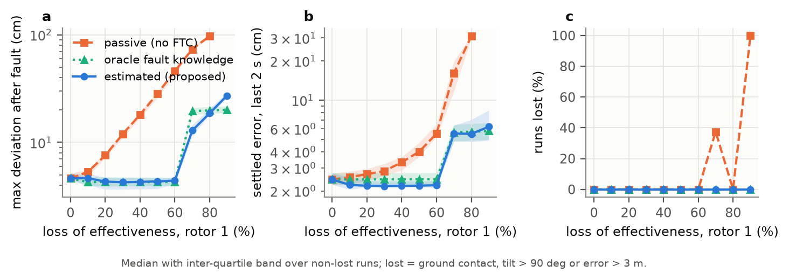

<!-- BEGIN:table_e1 -->
| LOE rotor 1 | Passive | Oracle | Estimated (proposed) |
|---|---|---|---|
| 20 % | 7.6 / 2.7 (0/8) | 4.3 / 2.5 (0/8) | 4.3 / 2.2 (0/8) |
| 40 % | 18.1 / 3.3 (0/8) | 4.3 / 2.5 (0/8) | 4.3 / 2.2 (0/8) |
| 60 % | 46.1 / 5.5 (0/8) | 4.3 / 2.5 (0/8) | 4.4 / 2.2 (0/8) |
| 70 % | 73.5 / 16.1 (3/8) | 19.5 / 5.6 (0/8) | 12.9 / 5.5 (0/8) |
| 80 % | 97.7 / 31.0 (0/8) | 19.8 / 5.7 (0/8) | 18.7 / 5.5 (0/8) |
| 90 % | -- / -- (8/8) | 20.1 / 5.8 (0/8) | 27.2 / 6.2 (0/8) |

*Hover, fault at t = 2 s. Each cell: median max deviation / median settled error (cm) over non-lost runs, (lost/total).*
<!-- END:table_e1 -->

With the estimated pipeline the peak deviation stays at the turbulence floor (about
4 cm) up to 60 % LOE, while the passive controller's peak deviation grows with the loss,
to about 45 cm at 60 %. The passive controller has integral action, so it does
eventually recover partial losses; the difference is in the transient and in the severe
range. From 70 % LOE the rotor can no longer carry its share of the weight: the active
pipelines switch to yaw-relaxed control and survive every run, while the passive
controller loses 3/8 runs at 70 % and all runs at 90 %.

Two results I did not expect. (i) At 80 % the passive controller survives all runs:
its yaw-last allocation lets the vehicle fall into an uncontrolled yaw spin that happens
to be stable, a passive version of the relaxed hover. (ii) At 70-80 % the estimated
pipeline has a *smaller* peak deviation than the oracle, because the oracle idles the
weakened rotor at the onset, whereas the estimated pipeline keeps using it for the
70-90 ms it takes the alarm and the estimate to cross the switching threshold. The oracle is an upper bound
on information, not on the switching policy.

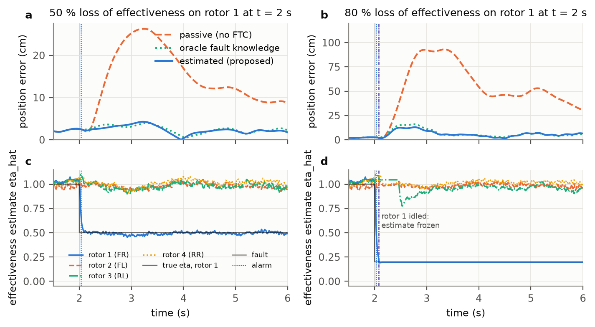

### 4.2 Fault detection and isolation (E2, E7)

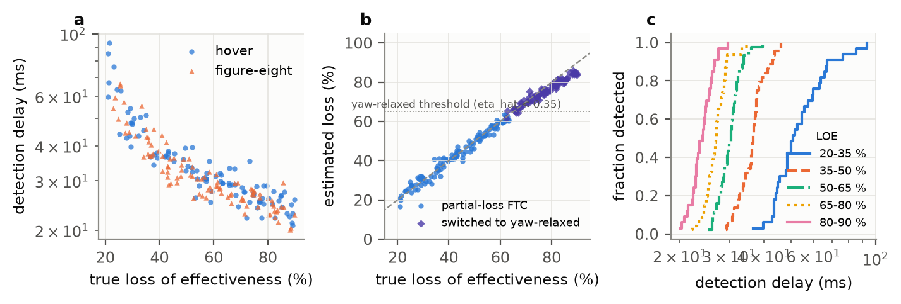

<!-- BEGIN:table_e2 -->
| LOE | detected | delay ms: median (p95) | isolation | |LOE error| pts: median (p95) |
|---|---|---|---|---|
| 20-35 % | 33/33 | 51 (80) | 100.0 % | 1.7 (4.6) |
| 35-50 % | 44/44 | 37 (43) | 100.0 % | 1.0 (4.4) |
| 50-65 % | 44/44 | 30 (35) | 100.0 % | 1.1 (2.7) |
| 65-80 % | 46/46 | 27 (32) | 100.0 % | 1.3 (3.7) |
| 80-90 % | 33/33 | 24 (27) | 100.0 % | 3.8 (5.4) |
| all 20-90 % | 200/200 | 30 (58) | 100.0 % | 1.5 (4.8) |

*200 faulty runs (hover and figure-eight). False alarms: 0 in 32 min of fault-free flight (100 fault-free runs incl. unseen aggressive steps, plus pre-onset time of the faulty runs).*
<!-- END:table_e2 -->

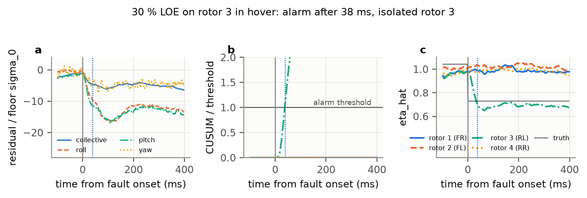

**Gyro noise.** Detection and isolation are essentially unaffected up to 8x the nominal
gyro noise (14 deg/s per sample), with re-calibrated thresholds and also with the
thresholds calibrated at 1x: in this model the residual floor is set by turbulence and
parameter mismatch, not by white gyro noise. The level-to-level variation of the median
delay mostly reflects the threshold calibration (the maximum over a few dozen fault-free
flights is a noisy statistic). I do not read this as "gyro noise does not matter" on a
real airframe: there the vibration is narrow-band, much larger and correlated with motor
speed, which the white-noise model does not capture (Section 6).

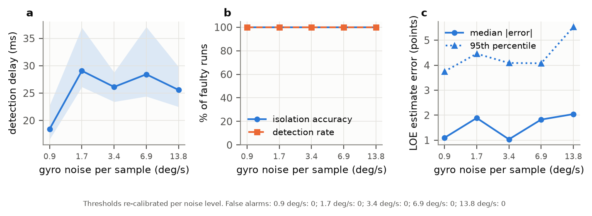

<!-- BEGIN:table_e2_noise -->
| gyro noise (deg/s) | detected | delay ms: median (p95) | isolation | |LOE err| pts | false alarms | false alarms, 1x thresholds | lost |
|---|---|---|---|---|---|---|---|
| 0.5x (0.9) | 40/40 | 18 (30) | 100.0 % | 1.1 | 0 | 0/20 runs | 0 |
| 1x (1.7) | 200/200 | 30 (58) | 100.0 % | 1.5 | 0 | -- | 0 |
| 2x (3.4) | 40/40 | 26 (34) | 100.0 % | 1.3 | 0 | 0/20 runs | 0 |
| 4x (6.9) | 40/40 | 29 (53) | 100.0 % | 1.7 | 0 | 0/20 runs | 0 |
| 8x (13.8) | 40/40 | 25 (48) | 100.0 % | 2.0 | 0 | 0/20 runs | 0 |

*1x = main experiment (200 + 100 runs); other levels 40 faulty + 20 fault-free runs with residual floor and thresholds re-calibrated for that level; the second false-alarm column re-flies the 20 fault-free runs with the thresholds calibrated at 1x.*
<!-- END:table_e2_noise -->

**Ablation (E7).** Each element of the diagnoser was removed in turn, and each variant
was re-calibrated with the same procedure and evaluated on the same 60 faulty and 30
fault-free flights:

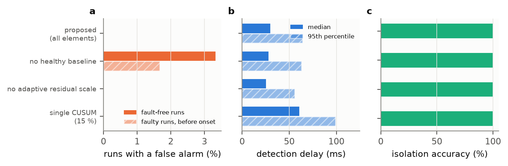

<!-- BEGIN:table_e7 -->
| FDI variant | detected | delay ms: median (p95) | isolation | |LOE err| pts | false-alarm runs (+ before onset) | lost |
|---|---|---|---|---|---|---|
| proposed (all elements) | 60/60 | 30 (64) | 100.0 % | 1.6 | 0/30 (+0) | 0 |
| no healthy baseline | 59/60 | 28 (63) | 100.0 % | 1.8 | 1/30 (+1) | 0 |
| no adaptive residual scale | 60/60 | 25 (56) | 100.0 % | 1.2 | 0/30 (+0) | 0 |
| single CUSUM (15 %) | 60/60 | 61 (99) | 100.0 % | 1.2 | 0/30 (+0) | 0 |

*60 faulty + 30 fault-free runs per variant (same seeds), each variant calibrated with the same procedure; detected counts alarms after onset.*
<!-- END:table_e7 -->

* Without the healthy baseline, static mismatch is left in the residual: one fault-free
  flight and one faulty flight (before its onset) raised false alarms, the latter also
  costing that run its detection.
* Replacing the CUSUM bank by a single test designed for 15 % LOE roughly doubles the
  median detection delay, because large faults then accumulate evidence at the rate of
  the small design shift.
* The adaptive residual scale made no measurable difference here: without it there were
  no false alarms either and detection was slightly faster. In these tests the
  calibrated floor alone was enough, so I cannot claim a benefit for this element; it is
  kept because it is the conservative choice for manoeuvres more aggressive than the
  ones tested.

### 4.3 Trajectory tracking with a 50 % loss (E3)

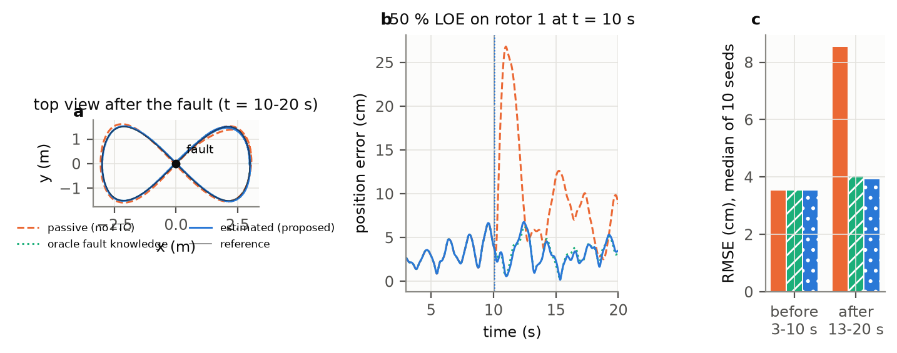

<!-- BEGIN:table_e3 -->
| Baseline | RMSE before | RMSE 0-3 s after | RMSE 3-10 s after | max dev. | lost |
|---|---|---|---|---|---|
| Passive | 3.5 | 17.6 | 8.5 | 24.7 | 0/10 |
| Oracle | 3.5 | 3.7 | 4.0 | 7.0 | 0/10 |
| Estimated (proposed) | 3.5 | 3.5 | 3.9 | 6.8 | 0/10 |

*Figure-eight (peak 3.3 m/s), 50 % LOE on rotor 1 at t = 10 s; medians over 10 seeds, cm.*
<!-- END:table_e3 -->

On the figure-eight (peak 3.3 m/s, peak acceleration 3.9 m/s^2) the 50 % loss costs the
passive controller a 25 cm excursion and more than doubles its tracking error for the rest
of the run; with the estimated pipeline the error stays at the pre-fault level (about
3.5-4 cm RMSE), indistinguishable from the oracle.

### 4.4 Complete loss of one rotor (E4, E5)

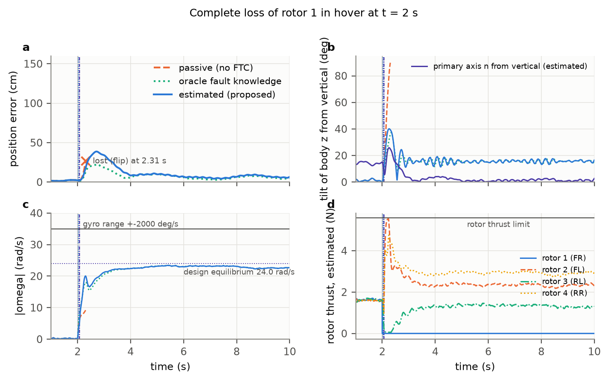

<!-- BEGIN:table_e4 -->
| case | baseline | lost | time to loss (s) | max dev. (cm) | settled (cm) | spin (rad/s) | switch delay (ms) |
|---|---|---|---|---|---|---|---|
| hover | Passive | 32/32 | 0.30 | -- | -- | -- | -- |
| hover | Oracle | 0/32 | -- | 21.5 | 6.4 | 23.2 | 0 |
| hover | Estimated (proposed) | 0/32 | -- | 37.9 | 7.6 | 23.2 | 62 |
| figure-eight | Passive | 24/24 | 0.29 | -- | -- | -- | -- |
| figure-eight | Oracle | 0/24 | -- | 25.4 | 16.7 | 23.6 | 0 |
| figure-eight | Estimated (proposed) | 0/24 | -- | 39.2 | 18.3 | 23.6 | 62 |

*Complete loss of one rotor (all four rotors in turn, several seeds each). Spin = mean |omega| over the last 2 s; switch delay = onset to yaw-relaxed control.*
<!-- END:table_e4 -->

The passive controller loses the vehicle in every run, typically by flipping within
0.3 s. The yaw-relaxed controller, engaged either by the oracle or by the estimated
pipeline, recovered every complete loss in hover and during the figure-eight. The
estimated pipeline pays for its ~60 ms switching delay with a larger transient (median
peak deviation about 38 cm against about 22 cm for the oracle). The body tilts by about
40 deg during the transient and then settles at about 15 deg (the primary-axis tilt)
while the primary axis itself points within a few degrees of vertical; the spin settles
at about 23 rad/s, two thirds of the gyro range.

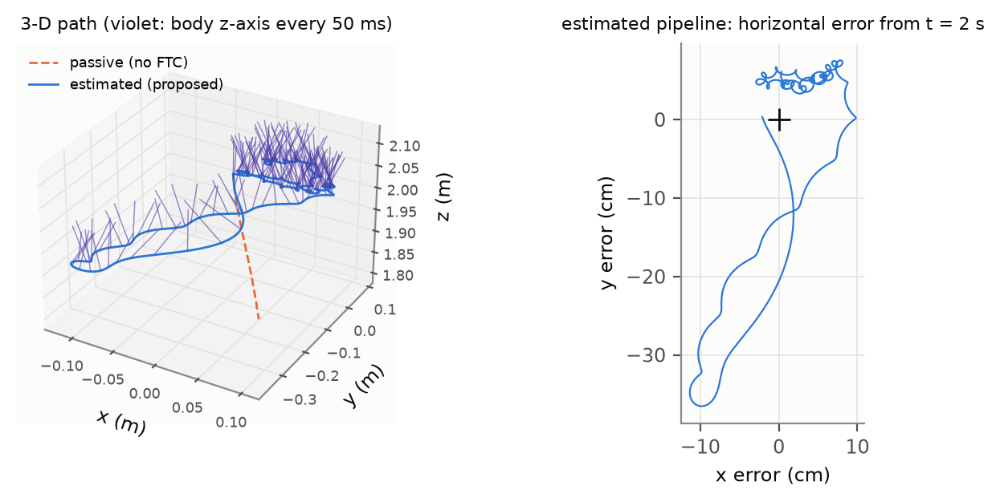

During the figure-eight (E5) the vehicle keeps following the trajectory while it spins;
the tracking error after the transient is about 15-18 cm, larger than in hover because the
position loop of the yaw-relaxed controller is deliberately slower than the nominal one.

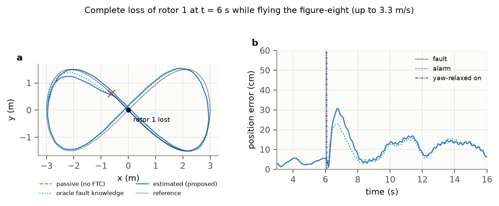

### 4.5 Where complete-loss recovery breaks (E6)

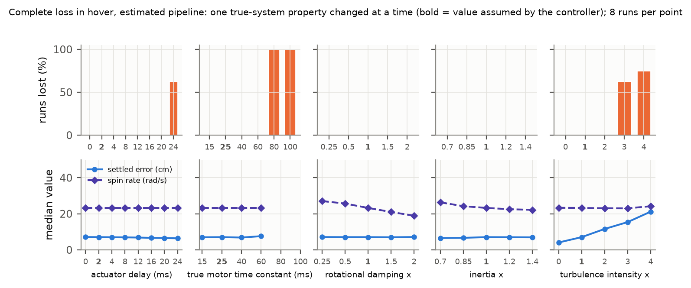

<!-- BEGIN:table_e6 -->
| true-system change | runs lost per value |
|---|---|
| actuator delay (ms) | 0: 0/8, 2: 0/8, 4: 0/8, 8: 0/8, 12: 0/8, 16: 0/8, 20: 0/8, 24: 5/8 |
| motor time constant (ms) | 15: 0/8, 25: 0/8, 40: 0/8, 60: 0/8, 80: 8/8, 100: 8/8 |
| rotational damping (x) | 0.25: 0/8, 0.5: 0/8, 1: 0/8, 1.5: 0/8, 2: 0/8 |
| inertia (x) | 0.7: 0/8, 0.85: 0/8, 1: 0/8, 1.2: 0/8, 1.4: 0/8 |
| turbulence (x) | 0: 0/8, 1: 0/8, 2: 0/8, 3: 5/8, 4: 6/8 |

*Complete loss in hover, estimated pipeline; the controller always assumes the nominal model.*
<!-- END:table_e6 -->

<!-- BEGIN:e6_text -->
Generated from `results/e6_robustness.json`. Every run recovered over the whole tested range of rotational damping (0.25-2 x nominal) and inertia (0.7-1.4 x nominal). Runs were lost for: actuator delay (24 ms: 5/8 lost; tested 0-24 ms, nominal 2); motor time constant (80 ms: 8/8 lost, 100 ms: 8/8 lost; tested 15-100 ms, nominal 25); turbulence (3 x default: 5/8 lost, 4 x default: 6/8 lost; tested 0-4 x default, nominal 1).
<!-- END:e6_text -->

The design is insensitive to the inertia (0.7-1.4x) and damping (0.25-2x) errors tested
and tolerates motors up to 2.4x slower than assumed (60 ms), but it fails when the
actuator transport delay reaches 24 ms (the controller assumes 2 ms; 20 ms still worked),
when the motors are 3.2x slower (80 ms), and at 3x the default turbulence. All three
failure modes act during the spin-up transient, where the relaxed equilibrium leaves
little control margin and the vehicle tilts by 40 deg or more before the spin is
established. A slower or delayed actuator path on a real quad would therefore be the
first thing to check.

## 5. Reproduce

Requires Python >= 3.11. On the machine used here (AMD Ryzen 7 5800H laptop CPU,
8 cores / 16 threads) the full study takes about <!-- BEGIN:runtime -->12<!-- END:runtime -->
minutes; it uses up to 16 worker processes (set `ROTORFAULT_WORKERS` to change that).

```bash
cd rotor-fault-recovery
make setup          # creates .venv and installs the package with dev extras
make test           # pytest suite (~30 s)
make lint           # ruff
make reproduce      # calibration + E1-E7 + figures + tables, end to end
```

Individual stages: `make experiments`, `make figures` (re-simulates the representative
runs if `results/cache` is missing), `make report`. One script does the same as
`make reproduce`: `python experiments/reproduce.py` (`--quick` runs a one-minute smoke
version). Single simulations from the command line:

```bash
rotorfault simulate --traj hover --rotor 1 --loe 1.0 --baseline estimated --plot run.png
rotorfault simulate --traj fig8 --rotor 3 --loe 0.5 --baseline passive --replay run.json
rotorfault equilibrium --rotor 1 --tilt 15
```

Every run is deterministic given its seed (`numpy.random.SeedSequence`, separate streams
for the vehicle draw, the sensors and the turbulence, identical across baselines). The
seed ranges of the calibration and of each experiment are disjoint
(`src/rotorfault/experiments/common.py`).

**Outputs.** `results/*.json` (summaries with their configuration), `results/*.csv` (one
row per run), `results/calibration.json`, `results/headline.json`, `results/summary.md`,
`figures/*.png` (200 dpi), `paper/generated/*.tex` (tables and number macros), and
down-sampled replays for a future web viewer in `results/replays/*.json` (50 Hz: time,
position, reference, quaternion, rotor thrusts, true and estimated effectiveness,
supervisor mode and event times).

## Repository layout

```
src/rotorfault/
  params.py         vehicle / sensor / timing parameters and their justification
  dynamics.py       6-DOF quaternion rigid body, rotor lag, RK4
  sensors.py        gyro, accelerometer, motion capture
  disturbance.py    turbulence (Ornstein-Uhlenbeck force and torque)
  faults.py         loss-of-effectiveness fault schedule
  estimation.py     attitude complementary filter, position/velocity KF (latency-aware)
  control.py        SE(3) geometric controller
  allocation.py     closed-form prioritised allocation
  fdi.py            filtered regression, Kalman filter on eta, CUSUM bank
  ftc.py            relaxed-hover equilibrium, gain-scheduled LQR, yaw-relaxed controller
  stack.py          flight stack: estimator + FDI + supervisor + controllers
  sim.py            closed-loop simulation and logging
  metrics.py        metric definitions
  scenarios.py      scenario factory
  cli.py            command-line interface
  experiments/      calibration, E1-E7, figures, report generation
experiments/        thin scripts: one per experiment, reproduce.py for everything
tests/              pytest suite (physics, allocation, FDI, control, determinism)
results/            generated JSON / CSV and replays
figures/            generated PNG figures
paper/              report.md, main.tex (IEEEtran), references.bib, generated/
docs/outreach.md    short summary for emails
```

## 6. Assumptions and limitations

* **Simulation only.** No hardware, no SITL, no flight logs. Nothing here has been
  validated on a real vehicle.
* **Parameters are assumed, not identified.** Mass and inertia come from a mass budget,
  thrust and drag coefficients from typical values. The rotational damping, which sets
  the spin rate after a complete loss, is the least certain number. E6 varies it 0.25-2x,
  but the real aerodynamics of a body rotating at 20+ rad/s (advancing and retreating
  blades, interaction with the failed rotor) is not modelled at all.
* **The FDI conditions are probably optimistic.** Real vibration on a 5-inch frame is
  narrow-band and much larger than the white noise used here, and the turbulence model
  is a simple Gauss-Markov process, not a validated wind model. The detection and
  isolation numbers should be read as "what the method does when its model is right";
  the noise and turbulence sweeps show trends, not field performance.
* **The fault model is a step in effectiveness on one rotor at a time.** Intermittent
  faults, slowly growing damage, two simultaneous faults, stuck motors and sensor faults
  are not considered. The FDI assumes a fault-free initial hover to learn its baseline,
  and it is not valid during the yaw-relaxed spin (a second fault would not be
  diagnosed).
* **Motion capture with 10 ms latency is assumed.** Outdoor flight with GNSS and a
  magnetometer is a different and harder estimation problem, especially while spinning.
* **The oracle is an upper bound on information, not on the policy** (Section 4.1).
* **Thresholds are calibrated from maxima of a few dozen flights**, a noisy statistic
  (Section 4.2); a field system would need much longer fault-free logs.
* **What did not work during development.** A single CUSUM designed for 10 % LOE had a
  long tail of turbulence-driven false alarms, which is why the smallest design size is
  15 % and the bank exists. A 1 s baseline window was biased by turbulence and produced a
  false alarm on a rotor with a 3 % weak propeller; the window is now 2.5 s. Detection
  against the nominal model (no baseline) is quantified in E7. The relaxed-hover family
  with the constraint "equal thrust on the two rotors next to the failed one" has no
  exact solution for this inertia ratio, which is why the primary-axis tilt is used as the
  design parameter instead.

## 7. Next steps

1. **PX4 SITL / Gazebo**: run the diagnoser in the loop against PX4's multicopter model
   and compare with PX4's own failure detector.
2. **Real logs**: run the diagnoser offline on Betaflight blackbox logs from my 5-inch
   quad (gyro, motor outputs, bidirectional-DShot RPM) to measure the real residual floor
   and false-alarm rate, and to identify inertia, thrust and damping coefficients.
3. **Flight tests** on a protected rig, first with a deliberately weakened propeller
   (partial LOE detection only), then with a sacrificial rotor cut.
4. **INDI comparison**: compare this model-based estimate-and-reallocate approach with
   incremental nonlinear dynamic inversion [5, 6], which is sensor-based and needs less
   model knowledge, especially for the complete-loss case.
5. **RPM telemetry**: put bidirectional-DShot RPM in the regression and check whether it
   removes the dependence on the motor model.

## References

1. T. Lee, M. Leok, N. H. McClamroch, "Geometric tracking control of a quadrotor UAV on
   SE(3)," *Proc. 49th IEEE Conf. Decision and Control (CDC)*, pp. 5420-5425, 2010.
2. M. W. Mueller, R. D'Andrea, "Stability and control of a quadrocopter despite the
   complete loss of one, two, or three propellers," *Proc. IEEE Int. Conf. Robotics and
   Automation (ICRA)*, 2014.
3. M. W. Mueller, R. D'Andrea, "Relaxed hover solutions for multicopters: Application to
   algorithmic redundancy and novel vehicles," *Int. J. Robotics Research*, 35(8),
   pp. 873-889, 2016.
4. A. Lanzon, A. Freddi, S. Longhi, "Flight control of a quadrotor vehicle subsequent to a
   rotor failure," *J. Guidance, Control, and Dynamics*, 37(2), pp. 580-591, 2014.
5. S. Sun, X. Wang, Q. Chu, C. de Visser, "Incremental nonlinear fault-tolerant control
   of a quadrotor with complete loss of two opposing rotors," *IEEE Trans. Robotics*,
   37(1), pp. 116-130, 2021.
6. E. J. J. Smeur, Q. Chu, G. C. H. E. de Croon, "Adaptive incremental nonlinear dynamic
   inversion for attitude control of micro air vehicles," *J. Guidance, Control, and
   Dynamics*, 39(3), pp. 450-461, 2016.
7. Y. Zhang, J. Jiang, "Bibliographical review on reconfigurable fault-tolerant control
   systems," *Annual Reviews in Control*, 32(2), pp. 229-252, 2008.
8. R. Mahony, V. Kumar, P. Corke, "Multirotor aerial vehicles: Modeling, estimation, and
   control of quadrotor," *IEEE Robotics & Automation Magazine*, 19(3), pp. 20-32, 2012.
9. E. S. Page, "Continuous inspection schemes," *Biometrika*, 41(1/2), pp. 100-115, 1954.
10. G. Lorden, "Procedures for reacting to a change in distribution," *Annals of
    Mathematical Statistics*, 42(6), pp. 1897-1908, 1971.
11. M. Basseville, I. V. Nikiforov, *Detection of Abrupt Changes: Theory and
    Application*, Prentice Hall, 1993.
12. R. C. Avram, X. Zhang, J. Muse, "Quadrotor actuator fault diagnosis and accommodation
    using nonlinear adaptive estimators," *IEEE Trans. Control Systems Technology*, 25(6),
    pp. 2219-2226, 2017.

## License and citation

MIT (see `LICENSE`). `CITATION.cff` has the citation metadata.
