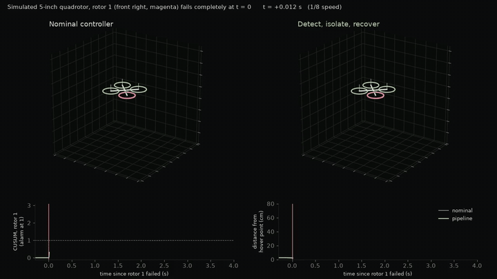
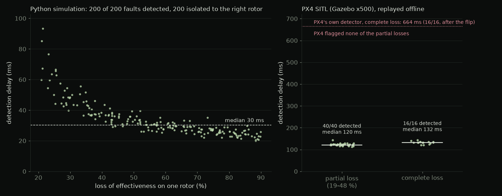
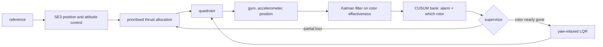

# Detect, isolate, recover: rotor-fault tolerance for a quadrotor

I built a pipeline that notices when one rotor of a small quadrotor weakens or stops, works out which rotor it is within tens of milliseconds, and keeps the vehicle in the air, including after a rotor stops completely.

[](https://github.com/Kronbii/rotor-fault-recovery/actions/workflows/ci.yml)


[](https://ramikronbi.com/projects/quadrotor-rotor-fault-recovery)

*Simulation, slowed down. The front-right rotor stops completely in hover. The nominal controller (left) flips within 0.3 s. The pipeline (right) flags the fault in 22 ms, switches to a yaw-relaxed controller at 58 ms and keeps the drone within 39 cm of its hover point.*

> **Status.** Everything here is simulation or PX4 software-in-the-loop. Nothing has flown with a fault yet, and the vehicle parameters are assumed, not identified on a real frame. The tethered test on the real quadrotor is prepared ([protocol](docs/tethered-test.md)), not done.

## What it is, and why it matters

A quadrotor has exactly as many actuators as it has things to control: one collective thrust and three torques. A hexacopter can route around a damaged propeller; a quadrotor cannot. A chipped propeller or a failing motor has to be noticed and compensated within tens of milliseconds, and a rotor that stops entirely can only be survived by giving up control of yaw and letting the vehicle spin. Flight software for small quadrotors mostly just disarms.

This repository is a reproducible study of that problem for a 5-inch FPV-class quadrotor (about 0.64 kg, thrust-to-weight 3.6). It holds the vehicle model, the estimator, the detector, the controllers, the simulator, every experiment, the PX4 software-in-the-loop automation, the generated results and figures, and the full write-up.

The clearest thing I learned: the control law that survives a rotor loss already exists. Handed the true fault the instant it happens, a yaw-relaxed controller recovered every complete loss. What separates a crash from a recovery is information: that a fault happened, which rotor it hit, and how much effectiveness is left, delivered fast enough to act on. So most of this project is an estimation problem.

## Results

All numbers below are regenerated by `make reproduce` (simulation) and `make sitl-analyze` (PX4 SITL), and were reproduced exactly on a rerun.

| | Result | Context |
|---|---|---|
| Detection and isolation, simulation | **200 / 200** | 20–90 % losses, each isolated to the right rotor; median delay 30 ms, 95th percentile 58 ms |
| Complete losses recovered, simulation | **56 / 56** | 32 in hover, 24 during a 3.3 m/s figure-eight; the nominal controller lost every one |
| Detection, PX4 SITL | **56 / 56** | 40 partial and 16 complete losses on PX4's x500 in Gazebo; median 120 and 132 ms |
| PX4's own failure detector, same flights | no partial loss flagged | complete losses flagged after a median 664 ms, once the vehicle had flipped |
| False alarms | **0** | in 32 min of fault-free simulated flight and 22 min of fault-free SITL flight |



*How fast a fault is caught: a 30 ms median over 200 simulated faults, and 120–132 ms in PX4 software-in-the-loop, where PX4's own detector took 664 ms.*

## How it works



1. **Model.** A 6-DOF simulator of a 5-inch quadrotor with sensor noise, 10 ms motion-capture latency, parameter spread and light turbulence. Every parameter and how I chose it is listed in the [write-up](paper/report.md).
2. **Estimate.** No sensor measures how well a rotor still works, so the pipeline infers it. The rotational dynamics and the vertical force balance are linear in the four rotor-effectiveness factors, so a Kalman filter tracks them from the gyro, the accelerometer and the velocity estimate. Every signal goes through the same filter, and detection runs against a healthy baseline learned in the first 2.5 s of hover, not against the nominal model.
3. **Detect and isolate.** A bank of CUSUM tests, designed for 15, 30 and 60 % losses and calibrated on separate fault-free flights, decides when a loss has happened and which rotor it hit. A single test tuned for small faults roughly doubled the median delay, from 30 to 61 ms.
4. **Recover.** Partial losses are handled by re-allocating thrust with the estimated effectiveness. When a rotor can no longer carry its share of the weight, a supervisor idles it and switches to a gain-scheduled yaw-relaxed LQR controller after Mueller and D'Andrea, accepting a spin of about 23 rad/s.
5. **Stress.** Monte-Carlo experiments against passive and oracle baselines, an ablation of the diagnoser, and robustness sweeps over actuator delay, motor lag and turbulence to find where recovery breaks.
6. **Validate.** 110 headless PX4 software-in-the-loop flights of the x500 in Gazebo, with motor faults injected in the simulated ESC and the diagnoser replayed offline on the flight logs. Details: [`sitl/README.md`](sitl/README.md).


*Simulation. (a) Peak position deviation after a loss on one rotor in hover; (b) share of runs in which the vehicle was lost; (c) one complete loss: the passive controller flips within about 0.3 s, the pipeline recovers.*

## Quick start

Requires Python 3.11 or newer. The full study takes about 12 minutes on an 8-core laptop (`ROTORFAULT_WORKERS` sets the number of worker processes).

```bash
git clone https://github.com/Kronbii/rotor-fault-recovery
cd rotor-fault-recovery
make setup        # creates .venv and installs the package with dev extras
make test         # pytest suite
make reproduce    # calibration, experiments E1-E7, figures and tables, end to end
```

`python experiments/reproduce.py --quick` runs a one-minute smoke version. Single runs from the command line (after `source .venv/bin/activate`):

```bash
rotorfault simulate --traj hover --rotor 1 --loe 1.0 --baseline estimated --plot run.png
rotorfault simulate --traj fig8 --rotor 3 --loe 0.5 --baseline passive --replay run.json
rotorfault equilibrium --rotor 1 --tilt 15
```

The diagnoser also runs offline on flight logs (PX4 ULog, or Betaflight blackbox decoded to CSV):

```bash
rotorfault calibrate-logs free1.csv free2.csv --airframe config/5inch.yaml --out cal.json
rotorfault replay flight.csv --airframe config/5inch.yaml --calibration cal.json --plot out.png
rotorfault identify free1.csv --airframe config/5inch.yaml
```

The PX4 SITL campaign needs PX4-Autopilot built for SITL and Gazebo Harmonic, so it is not part of `make reproduce` or CI: `make sitl-setup`, `make sitl-campaign`, `make sitl-analyze`. See [`sitl/README.md`](sitl/README.md).

## Repository layout

```
src/rotorfault/   simulator, estimator, CUSUM detector, controllers, log readers, CLI
experiments/      one thin script per experiment; reproduce.py runs everything
sitl/             PX4 SITL harness, campaign, analysis, results and figures
config/           airframe file of the real 5-inch quad (assumed values until identified)
results/          generated JSON and CSV, headline numbers, replays
figures/          generated figures
paper/            the full write-up: report.md, main.tex and main.pdf
docs/             tethered-test protocol and summaries
tests/            pytest suite, including a PX4 SITL log excerpt
```

## Limits and what's next

- Everything is simulation or software-in-the-loop. Nothing has flown with a fault yet, and the vehicle parameters are assumed rather than identified on a real frame.
- Simulated and Gazebo sensors are far cleaner than a vibrating 5-inch frame, so the false-alarm numbers are optimistic. The detection numbers describe what the method does when its model is right.
- In PX4 SITL the diagnoser ran offline on the flight logs; no fault-tolerant controller ran inside PX4.
- Complete-loss recovery started to fail at 24 ms of actuator delay (2 ms assumed), with motors 3.2 times slower than modelled, and at three times the default turbulence.

Next: blackbox logs from a real flight, then the [tethered test](docs/tethered-test.md) on the real quadrotor, then running the diagnoser inside PX4 and handing its alarm to a fault-tolerant controller.

## Read more

- Project page: [ramikronbi.com/projects/quadrotor-rotor-fault-recovery](https://ramikronbi.com/projects/quadrotor-rotor-fault-recovery)
- Write-up: [What losing a rotor teaches about estimation](https://ramikronbi.com/writing/what-losing-a-rotor-teaches-about-estimation)
- The full study, with every table, assumption and reference: [`paper/report.md`](paper/report.md) and [`paper/main.pdf`](paper/main.pdf)
- The yaw-relaxed controller follows M. W. Mueller and R. D'Andrea, [Stability and control of a quadrocopter despite the complete loss of one, two, or three propellers](https://doi.org/10.1109/ICRA.2014.6906588), ICRA 2014.
- This study is also the simulator for session 6 of my [drone-control bootcamp](https://github.com/Kronbii/drone-control-bootcamp).

MIT licence ([LICENSE](LICENSE)); citation metadata in [CITATION.cff](CITATION.cff).

Built by Rami Kronbi — [ramikronbi.com](https://ramikronbi.com)
