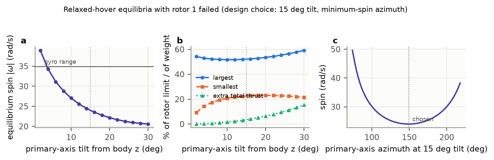

# Detect, Isolate, Recover: Rotor-Fault Tolerance for a 5-inch Quadrotor (Simulation Study)

**Rami Kronbi**, independent researcher — code and data: `rotor-fault-recovery` (MIT license)

*This is the Markdown version of `paper/main.tex`. Blocks between `<!-- BEGIN:... -->`
markers are generated from `results/*.json` by `make report`.*

## Abstract

<!-- BEGIN:abstract -->
We study rotor-fault tolerance for a simulated 5-inch FPV-class quadrotor (0.64 kg, thrust-to-weight 3.6) with sensor noise, a 10 ms motion-capture latency, parameter uncertainty and light turbulence. An online estimator of the four rotor effectiveness factors (filtered rigid-body regression, Kalman filter) feeds a bank of CUSUM tests for detection and isolation; a supervisor then either re-allocates thrust with the estimated effectiveness (partial loss) or, when a rotor can no longer carry its share of the weight, switches to a yaw-relaxed controller in the spirit of Mueller and D'Andrea (2014) that spins the vehicle about a tilted primary axis (gain-scheduled LQR on the reduced attitude). In 200 Monte-Carlo runs with 20-90 % loss of effectiveness, all faults were detected (median delay 30 ms, 95th percentile 58 ms) and all were isolated to the correct rotor, with a median magnitude error of 1.5 percentage points; no false alarm occurred in 32 min of fault-free flight. With a 50 % loss in hover the median peak deviation drops from 28 cm (passive) to 4.3 cm. After a complete rotor loss in hover the passive controller lost the vehicle in 32/32 runs (median 0.30 s), while the proposed pipeline recovered 32/32 with a median peak deviation of 38 cm and a spin of 23 rad/s; it also recovered 24/24 complete losses during a 3.3 m/s figure-eight. These are simulation results with assumed, not identified, parameters; in the robustness sweeps complete-loss recovery started to fail at an actuator delay of 24 ms (2 ms assumed), a motor time constant of 80 ms (25 ms assumed) and 3x the default turbulence.
<!-- END:abstract -->

## 1. Introduction

A quadrotor has as many actuators as controlled degrees of freedom, so a damaged
propeller, a prop strike or a failed motor channel cannot be compensated by redundancy.
Small FPV-class vehicles meet such faults routinely, and their flight software usually
treats them only as a reason to disarm.

Fault-tolerant control (FTC) of multirotors is a mature topic. Zhang and Jiang [7]
review reconfigurable FTC in general; Avram et al. [12] showed model-based actuator
fault diagnosis and accommodation on a quadrotor. The complete loss of a rotor has been
handled by giving up yaw: Mueller and D'Andrea derived "relaxed hover" solutions in which
the vehicle spins about a body-fixed primary axis, and controlled the reduced attitude
with LQR [2, 3]; Lanzon et al. designed a controller for the same situation [4]; Sun et
al. used incremental nonlinear dynamic inversion (INDI) [6] to fly a quadrotor with two
opposing rotors lost at high speed [5].

This report puts these pieces together for one vehicle class, a 5-inch FPV quadrotor
with a thrust-to-weight ratio of 3.6, and asks three questions: how fast and how reliably
can a loss of effectiveness (LOE) be detected, isolated and quantified without RPM
telemetry; how much does acting on that estimate help, compared with a passive
controller and with an oracle; and where does yaw-relaxed recovery from a complete loss
break? The contribution is not a new control law. It is an end-to-end, reproducible
pipeline evaluated under sensor noise, motion-capture latency, parameter spread and
turbulence, with its failure limits reported.


*Fig. 1 — Pipeline. The supervisor switches between nominal, partial-loss (re-allocation
with the estimated effectiveness) and yaw-relaxed control.*

## 2. Model

**Vehicle.** Position `p` and velocity `v` in a z-up world frame, unit-quaternion
attitude (rotation `R`), body rate `w`, rotor speeds `W_i`:

```
m dv/dt  = -m g e3 + R T e3 - R D R^T v - c |v| v + F_d
J dw/dt  = tau(f, dW/dt) - w x (J w + h_r) - K_w w + tau_d
dW_i/dt  = (W_cmd,i - W_i) / tau_m,        f_i = eta_i k_f W_i^2
```

with rotor angular momentum `h_r`, yaw reaction torque `kappa f_i` per rotor plus the
reaction of accelerating rotors, and turbulence `F_d`, `tau_d` (independent
Ornstein-Uhlenbeck processes, 0.15 N and 4e-3 N m, 0.3 s correlation). `eta_i in [0, 1]`
is the effectiveness of rotor `i`; a fault is a step in one `eta_i`. Mass (0.638 kg) and
inertia (diag(1.36, 2.12, 3.13) e-3 kg m^2) come from a lumped mass budget; arm length
0.11 m, 5.6 N maximum rotor thrust, `kappa = 0.015 m`, `tau_m = 25 ms`, rotational damping
(2.5, 2.5, 2.0) e-3 N m s. The true vehicle of each run is drawn around these values
(mass +-3 %, inertia +-5 %, `k_f` +-3 % per rotor, `tau_m` +-10 %, damping +-20 %); the
flight software always uses the nominal model. Integration is RK4 at 1 kHz; estimation,
FDI and control run at 500 Hz with a 2 ms actuator transport delay. The full parameter
table with the reasoning behind each value is in the README.

**Sensors.** Gyro with 0.03 rad/s white noise per sample, random-walk bias and
+-2000 deg/s range; accelerometer with 0.2 m/s^2 noise and bias; motion capture at 100 Hz
with 1 mm / 0.3 deg noise and 10 ms latency. A complementary attitude filter and a
position/velocity Kalman filter fuse them, using a time-stamped history for the delayed
motion-capture samples. Controllers and the diagnoser never see the true state.

## 3. Nominal control and allocation

The nominal controller is the geometric tracking controller on SE(3) of Lee et al. [1]
(z-up form), with integral action on position and attitude, tilt limits and drag
feed-forward; its SO(3) attitude error has no singularities and behaves well for the
large errors that follow a fault. Allocation solves `[T, tau] = B diag(eta) f` under
`f_min <= f <= f_max` in closed form with priorities: the roll/pitch torque is kept
(scaled only if infeasible), the collective thrust is shifted by the smallest feasible
amount, and the yaw torque is scaled last.

## 4. Fault detection, isolation and estimation

**Regression.** The rotational dynamics and the body-z force balance are linear in `eta`:

```
y = [ m a_z + D_z v_z + c|v| v_z ;  J dw/dt + w x (J w + h_r) + K_w w - tau_dW ]
  = B diag(f_hat) eta = Phi eta
```

where `f_hat` are the thrusts predicted from the commands through the nominal motor model
and the known delay. `dw/dt` comes from a 15 Hz second-order state-variable filter of the
gyro, and every other signal of the regression passes through the same filter.

**Estimation.** A Kalman filter with a random-walk model on `eta` (equivalently RLS with
forgetting) tracks `eta_hat`, projected onto [0, 1.1]; rotors commanded near idle are
frozen. Static mismatch (3 % thrust-coefficient spread, mass error) is indistinguishable
from a small LOE, so the estimate is averaged over the initial 2.5 s hover into a healthy
baseline `eta_ref`.

**Detection and isolation.** Each residual row is normalised by
`sigma_k = sqrt(sigma_0^2 + u_k^2)`, a calibrated floor plus the residual that the assumed
inertia (5 %) and motor-lag (10 %) uncertainty can produce at that instant. A loss `delta`
on rotor `j` shifts `r = (y - Phi eta_ref) / sigma` by `delta d_j` with the known signature
`d_j = -Phi[:, j] eta_ref,j / sigma`. With `t_j = d_j^T r / |d_j|`, a bank of one-sided
CUSUM tests [9, 11]

```
g_kj <- max(0, g_kj + mu_kj (t_j - mu_kj / 2)),    mu_kj = delta_k |d_j|,
```

for `delta_k in {0.15, 0.3, 0.6}` approximates the GLR test for an unknown fault size
(cf. Lorden [10]). An alarm is raised when any `g_kj > h_k`, and the rotor `argmax_j g_kj`
of the firing test is isolated. Because the residual is coloured and the model inexact,
`sigma_0` and `h_k` are calibrated on 60 fault-free flights with seeds disjoint from all
evaluation runs: `h_k` is twice the largest statistic observed, floored at the evidence a
design-size fault accumulates in 20 ms. The aggressive waypoint manoeuvre is excluded
from calibration.

## 5. Fault-tolerant control

**Partial loss.** After an alarm the allocation uses `B diag(eta_hat)`.

**Complete loss.** If `eta_hat_j < 0.35` for 30 ms (below about 0.29 the rotor cannot
carry a quarter of the weight), rotor `j` is idled and a yaw-relaxed controller in the
spirit of [2, 3] takes over. The relaxed-hover equilibrium is computed numerically: three
thrusts and a constant body rate along a body-fixed axis `n_bar` such that all torques
balance (including rotor gyroscopics and damping) and `f_T n_bar_z = m g`. The solutions
form a two-parameter family; I fix the tilt of `n_bar` from body z at 15 deg and choose
its azimuth to minimise the spin (Fig. 2), which gives 24 rad/s, 69 % of the gyro range.
The reduced dynamics (p, q, the two components of the axis error in the plane orthogonal
to `n_bar`, with `dn/dt = -w x n` for the desired axis expressed in the body frame, and
three motor states) are linearised numerically about quasi-equilibria with the yaw rate
frozen at 14 values between 0 and 1.3 times the equilibrium spin; a discrete LQR is
computed at each point and scheduled on the measured yaw rate, as is the gyroscopic torque
feed-forward. An outer position loop commands the direction of `n_bar` and the thrust
`f_T = m |a_cmd| / n_bar_z`.



*Fig. 2 — Relaxed-hover equilibria after the loss of rotor 1 versus primary-axis tilt and
azimuth.*

**Baselines.** *Passive*: nominal controller, faults ignored. *Oracle*: the true `eta`
and onset are given to the supervisor. *Estimated*: the proposed pipeline. For a given
seed, all three see the same vehicle, noise and turbulence.

## 6. Experiments

E1: hover, step LOE 0-90 % on rotor 1 at t = 2 s, 8 seeds per point. E2: 200 faulty runs
(random rotor, LOE ~ U[0.2, 0.9], onset ~ U[2, 5] s, hover or a figure-eight at up to
3.3 m/s) and 100 fault-free runs of 12 s (hover, figure-eight, aggressive waypoint steps),
plus a gyro-noise sweep (0.5-8x, re-calibrated per level). E3: figure-eight with 50 % LOE
at t = 10 s. E4/E5: complete loss of each rotor in hover / on the figure-eight. E6:
robustness of E4 to the true actuator delay, motor time constant, damping, inertia and
turbulence. E7: FDI ablation. A run is *lost* on ground contact, tilt > 90 deg or
position error > 3 m.

## 7. Results

### Partial loss (E1, E3)


*Fig. 3 — E1: peak deviation, settled error and loss rate versus LOE magnitude (median and
inter-quartile range, 8 seeds).*

<!-- BEGIN:table_e1 -->
| LOE rotor 1 | Passive | Oracle | Estimated (proposed) |
|---|---|---|---|
| 20 % | 7.6 / 2.7 (0/8) | 4.3 / 2.5 (0/8) | 4.3 / 2.2 (0/8) |
| 40 % | 18.1 / 3.3 (0/8) | 4.3 / 2.5 (0/8) | 4.3 / 2.2 (0/8) |
| 60 % | 46.1 / 5.5 (0/8) | 4.3 / 2.5 (0/8) | 4.4 / 2.2 (0/8) |
| 70 % | 73.5 / 16.1 (3/8) | 19.5 / 5.6 (0/8) | 12.9 / 5.5 (0/8) |
| 80 % | 97.7 / 31.0 (0/8) | 19.8 / 5.7 (0/8) | 18.7 / 5.5 (0/8) |
| 90 % | -- / -- (8/8) | 20.1 / 5.8 (0/8) | 27.2 / 6.2 (0/8) |

*Hover, fault at t = 2 s. Each cell: median max deviation / median settled error (cm) over non-lost runs, (lost/total).*
<!-- END:table_e1 -->

With the estimated pipeline the peak deviation stays at the turbulence floor up to 60 %
LOE. The passive controller recovers partial losses eventually through its integrators
but has much larger transients, and it loses runs at 70 % and 90 %; the active pipelines
lose none. Two unexpected results: at 80 % the passive vehicle survives in an
uncontrolled but stable yaw spin, and at 70-80 % the estimated pipeline beats the oracle,
because the oracle idles the weakened rotor at the onset while the estimated pipeline
keeps using it until its estimate crosses the threshold.


<!-- BEGIN:table_e3 -->
| Baseline | RMSE before | RMSE 0-3 s after | RMSE 3-10 s after | max dev. | lost |
|---|---|---|---|---|---|
| Passive | 3.5 | 17.6 | 8.5 | 24.7 | 0/10 |
| Oracle | 3.5 | 3.7 | 4.0 | 7.0 | 0/10 |
| Estimated (proposed) | 3.5 | 3.5 | 3.9 | 6.8 | 0/10 |

*Figure-eight (peak 3.3 m/s), 50 % LOE on rotor 1 at t = 10 s; medians over 10 seeds, cm.*
<!-- END:table_e3 -->

### Diagnosis (E2, E7)


*Fig. 4 — E2: detection delay versus LOE, estimated versus true LOE, and the delay
distribution per magnitude bin (200 runs).*

<!-- BEGIN:table_e2 -->
| LOE | detected | delay ms: median (p95) | isolation | abs. LOE error, pts: median (p95) |
|---|---|---|---|---|
| 20-35 % | 33/33 | 51 (80) | 100.0 % | 1.7 (4.6) |
| 35-50 % | 44/44 | 37 (43) | 100.0 % | 1.0 (4.4) |
| 50-65 % | 44/44 | 30 (35) | 100.0 % | 1.1 (2.7) |
| 65-80 % | 46/46 | 27 (32) | 100.0 % | 1.3 (3.7) |
| 80-90 % | 33/33 | 24 (27) | 100.0 % | 3.8 (5.4) |
| all 20-90 % | 200/200 | 30 (58) | 100.0 % | 1.5 (4.8) |

*200 faulty runs (hover and figure-eight). False alarms: 0 in 32 min of fault-free flight (100 fault-free runs incl. unseen aggressive steps, plus pre-onset time of the faulty runs).*
<!-- END:table_e2 -->


<!-- BEGIN:table_e2_noise -->
| gyro noise (deg/s) | detected | delay ms: median (p95) | isolation | abs. LOE error, pts | false alarms | false alarms, 1x thresholds | lost |
|---|---|---|---|---|---|---|---|
| 0.5x (0.9) | 40/40 | 18 (30) | 100.0 % | 1.1 | 0 | 0/20 runs | 0 |
| 1x (1.7) | 200/200 | 30 (58) | 100.0 % | 1.5 | 0 | -- | 0 |
| 2x (3.4) | 40/40 | 26 (34) | 100.0 % | 1.3 | 0 | 0/20 runs | 0 |
| 4x (6.9) | 40/40 | 29 (53) | 100.0 % | 1.7 | 0 | 0/20 runs | 0 |
| 8x (13.8) | 40/40 | 25 (48) | 100.0 % | 2.0 | 0 | 0/20 runs | 0 |

*1x = main experiment (200 + 100 runs); other levels 40 faulty + 20 fault-free runs with residual floor and thresholds re-calibrated for that level; the second false-alarm column re-flies the 20 fault-free runs with the thresholds calibrated at 1x.*
<!-- END:table_e2_noise -->

Up to 8x gyro noise, detection and isolation are essentially unchanged, with re-calibrated
thresholds and also with the thresholds calibrated at 1x: in this model turbulence and
mismatch, not white gyro noise, set the residual floor. Real vibration is narrow-band and
larger, so this should not be read as "gyro noise does not matter" on a real airframe.


<!-- BEGIN:table_e7 -->
| FDI variant | detected | delay ms: median (p95) | isolation | abs. LOE error, pts | false-alarm runs (+ before onset) | lost |
|---|---|---|---|---|---|---|
| proposed (all elements) | 60/60 | 30 (64) | 100.0 % | 1.6 | 0/30 (+0) | 0 |
| no healthy baseline | 59/60 | 28 (63) | 100.0 % | 1.8 | 1/30 (+1) | 0 |
| no adaptive residual scale | 60/60 | 25 (56) | 100.0 % | 1.2 | 0/30 (+0) | 0 |
| single CUSUM (15 %) | 60/60 | 61 (99) | 100.0 % | 1.2 | 0/30 (+0) | 0 |

*60 faulty + 30 fault-free runs per variant (same seeds), each variant calibrated with the same procedure; detected counts alarms after onset.*
<!-- END:table_e7 -->

### Complete loss (E4, E5)


*Fig. 5 — E4: complete loss of rotor 1 in hover: position error, tilt, spin rate and rotor
thrusts.*

<!-- BEGIN:table_e4 -->
| case | baseline | lost | time to loss (s) | max dev. (cm) | settled (cm) | spin (rad/s) | switch delay (ms) |
|---|---|---|---|---|---|---|---|
| hover | Passive | 32/32 | 0.30 | -- | -- | -- | -- |
| hover | Oracle | 0/32 | -- | 21.5 | 6.4 | 23.2 | 0 |
| hover | Estimated (proposed) | 0/32 | -- | 37.9 | 7.6 | 23.2 | 62 |
| figure-eight | Passive | 24/24 | 0.29 | -- | -- | -- | -- |
| figure-eight | Oracle | 0/24 | -- | 25.4 | 16.7 | 23.6 | 0 |
| figure-eight | Estimated (proposed) | 0/24 | -- | 39.2 | 18.3 | 23.6 | 62 |

*Complete loss of one rotor (all four rotors in turn, several seeds each). Spin = mean |omega| over the last 2 s; switch delay = onset to yaw-relaxed control.*
<!-- END:table_e4 -->


### Limits (E6)


<!-- BEGIN:table_e6 -->
| true-system change | runs lost per value |
|---|---|
| actuator delay (ms) | 0: 0/8, 2: 0/8, 4: 0/8, 8: 0/8, 12: 0/8, 16: 0/8, 20: 0/8, 24: 5/8 |
| motor time constant (ms) | 15: 0/8, 25: 0/8, 40: 0/8, 60: 0/8, 80: 8/8, 100: 8/8 |
| rotational damping (x) | 0.25: 0/8, 0.5: 0/8, 1: 0/8, 1.5: 0/8, 2: 0/8 |
| inertia (x) | 0.7: 0/8, 0.85: 0/8, 1: 0/8, 1.2: 0/8, 1.4: 0/8 |
| turbulence (x) | 0: 0/8, 1: 0/8, 2: 0/8, 3: 5/8, 4: 6/8 |

*Complete loss in hover, estimated pipeline; the controller always assumes the nominal model.*
<!-- END:table_e6 -->

<!-- BEGIN:e6_text -->
Generated from `results/e6_robustness.json`. Every run recovered over the whole tested range of rotational damping (0.25-2 x nominal) and inertia (0.7-1.4 x nominal). Runs were lost for: actuator delay (24 ms: 5/8 lost; tested 0-24 ms, nominal 2); motor time constant (80 ms: 8/8 lost, 100 ms: 8/8 lost; tested 15-100 ms, nominal 25); turbulence (3 x default: 5/8 lost, 4 x default: 6/8 lost; tested 0-4 x default, nominal 1).
<!-- END:e6_text -->

The design tolerates the inertia and damping errors tested and motors up to 2.4x slower
than assumed, but fails at 24 ms actuator delay, 80 ms motor time constant and 3x the
default turbulence. All three act during the spin-up transient, where the relaxed
equilibrium leaves little control margin.

## 8. Discussion and limitations

The results support the pipeline *in simulation*: diagnosis is fast enough that the
partial-loss transient stays at the turbulence floor, and fast enough to hand a complete
loss to the yaw-relaxed controller within about 60 ms. They do not show that it works on
a real 5-inch quadrotor.

* All parameters are assumed. The rotational damping that sets the spin rate is the least
  certain, and the aerodynamics of a body spinning at more than 20 rad/s is not modelled.
* Real vibration is narrow-band and larger than the white noise used here, and the
  turbulence model is a simple Gauss-Markov process, so the near-perfect detection
  numbers are an upper bound.
* Faults are single steps. Intermittent or growing damage, multiple faults and sensor
  faults are not studied; the baseline assumes a fault-free initial hover; the diagnoser
  is not valid during the relaxed spin.
* Motion capture is assumed; GNSS and magnetometer estimation while spinning is harder.
* Thresholds are calibrated from maxima of a few dozen flights, which is a noisy
  statistic.
* The oracle is an upper bound on information, not on the switching policy.

## 9. Conclusion and next steps

A model-based diagnoser (filtered rigid-body regression, Kalman filter, CUSUM bank)
combined with re-allocation for partial losses and a gain-scheduled yaw-relaxed controller
for complete losses recovered every simulated rotor fault in the main experiments,
including complete losses during 3.3 m/s flight; in the robustness sweeps it failed at
large actuator delay, very slow motors and strong turbulence. Next: PX4 SITL; offline evaluation on Betaflight blackbox logs of a real
5-inch quadrotor (with identification of its parameters and use of RPM telemetry);
protected flight tests with a weakened and then a cut propeller; and a comparison with
INDI-based FTC [5, 6].

## References

1. T. Lee, M. Leok, N. H. McClamroch, "Geometric tracking control of a quadrotor UAV on
   SE(3)," Proc. 49th IEEE CDC, pp. 5420-5425, 2010.
2. M. W. Mueller, R. D'Andrea, "Stability and control of a quadrocopter despite the
   complete loss of one, two, or three propellers," Proc. IEEE ICRA, 2014.
3. M. W. Mueller, R. D'Andrea, "Relaxed hover solutions for multicopters: Application to
   algorithmic redundancy and novel vehicles," Int. J. Robotics Research, 35(8),
   pp. 873-889, 2016.
4. A. Lanzon, A. Freddi, S. Longhi, "Flight control of a quadrotor vehicle subsequent to a
   rotor failure," J. Guidance, Control, and Dynamics, 37(2), pp. 580-591, 2014.
5. S. Sun, X. Wang, Q. Chu, C. de Visser, "Incremental nonlinear fault-tolerant control
   of a quadrotor with complete loss of two opposing rotors," IEEE Trans. Robotics, 37(1),
   pp. 116-130, 2021.
6. E. J. J. Smeur, Q. Chu, G. C. H. E. de Croon, "Adaptive incremental nonlinear dynamic
   inversion for attitude control of micro air vehicles," J. Guidance, Control, and
   Dynamics, 39(3), pp. 450-461, 2016.
7. Y. Zhang, J. Jiang, "Bibliographical review on reconfigurable fault-tolerant control
   systems," Annual Reviews in Control, 32(2), pp. 229-252, 2008.
8. R. Mahony, V. Kumar, P. Corke, "Multirotor aerial vehicles: Modeling, estimation, and
   control of quadrotor," IEEE Robotics & Automation Magazine, 19(3), pp. 20-32, 2012.
9. E. S. Page, "Continuous inspection schemes," Biometrika, 41(1/2), pp. 100-115, 1954.
10. G. Lorden, "Procedures for reacting to a change in distribution," Annals of
    Mathematical Statistics, 42(6), pp. 1897-1908, 1971.
11. M. Basseville, I. V. Nikiforov, Detection of Abrupt Changes: Theory and Application,
    Prentice Hall, 1993.
12. R. C. Avram, X. Zhang, J. Muse, "Quadrotor actuator fault diagnosis and accommodation
    using nonlinear adaptive estimators," IEEE Trans. Control Systems Technology, 25(6),
    pp. 2219-2226, 2017.
